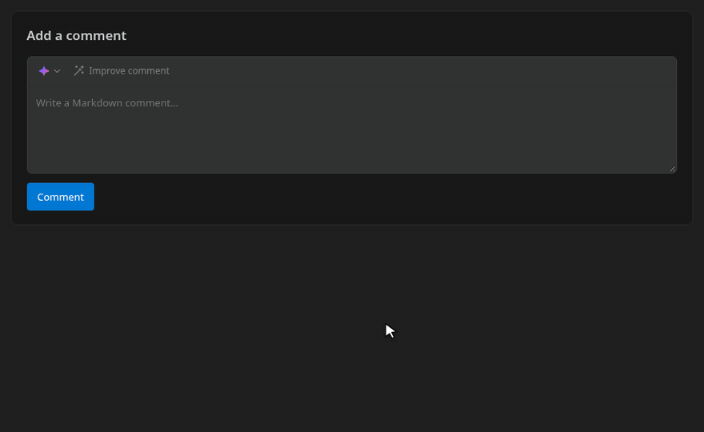
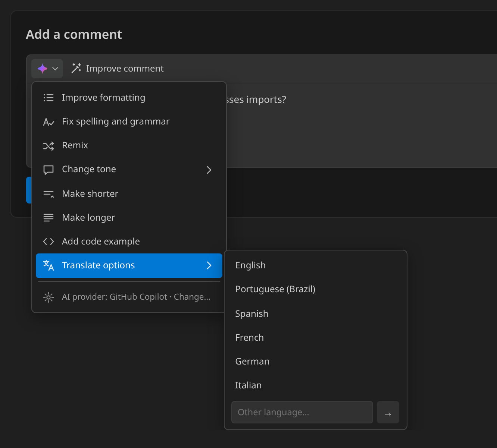
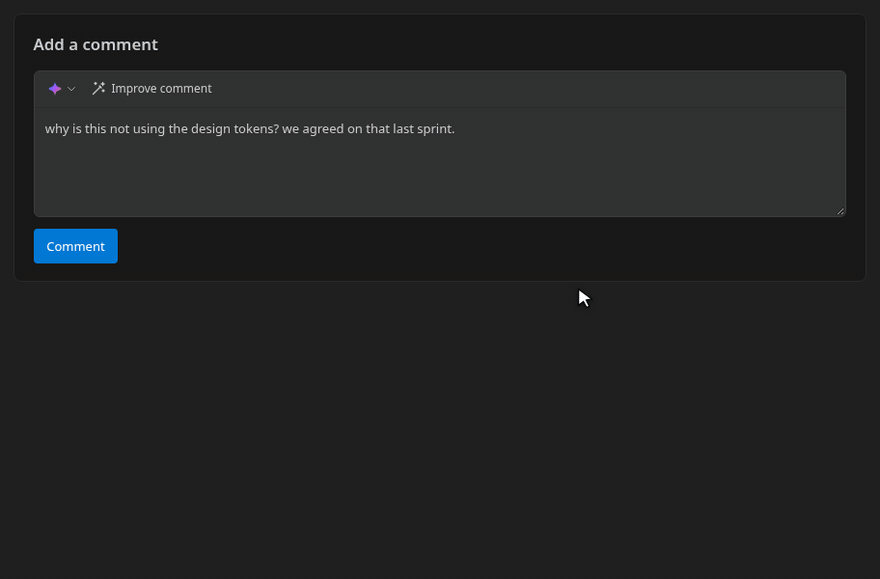
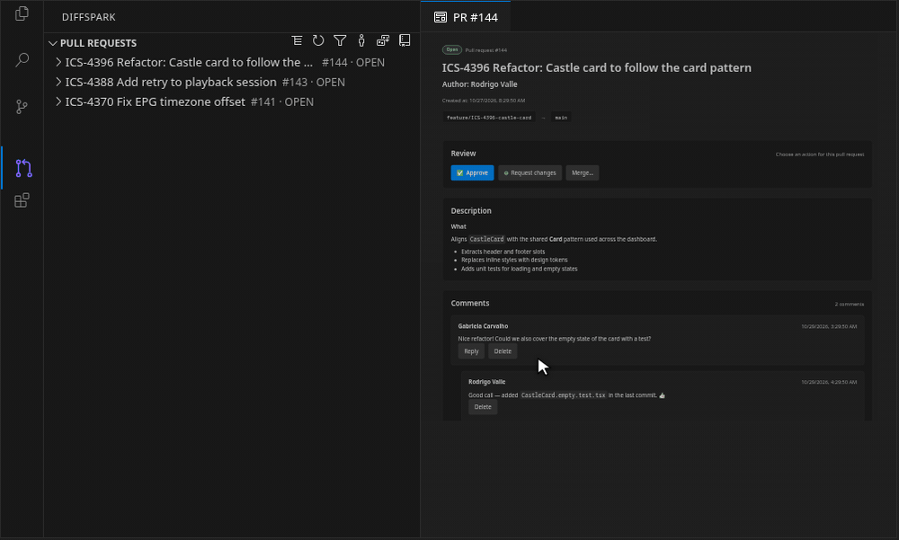
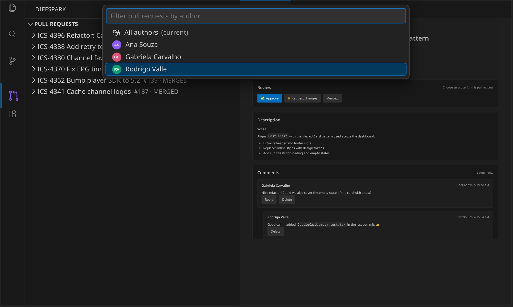
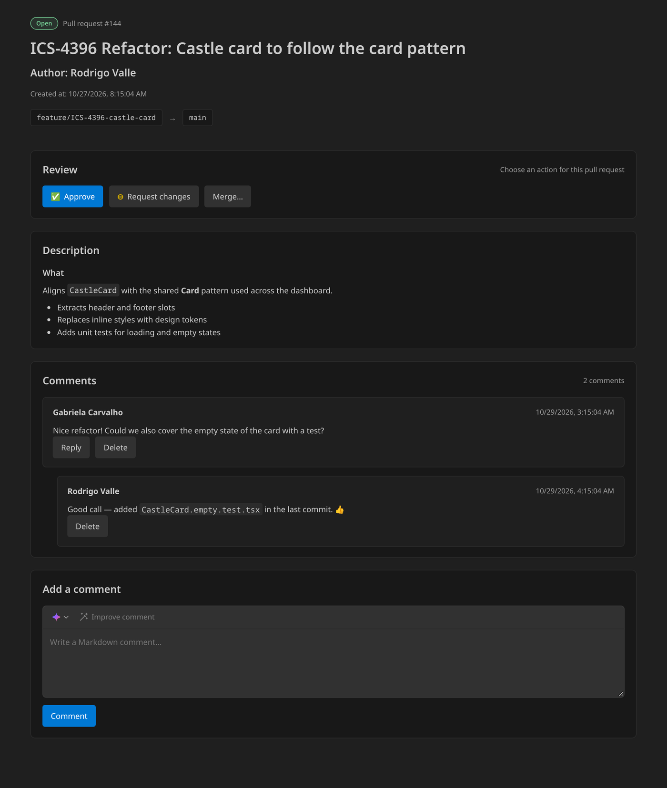

<p align="center">
  
</p>

<h3 align="center">Smarter reviews. Better code.</h3>

<p align="center">
  Review Bitbucket Cloud pull requests without leaving VS Code — browse, diff, comment, approve, and merge, with AI that helps you write better feedback.
</p>

<p align="center">
  <a href="https://github.com/thiagopsnfg/diffspark/blob/main/LICENSE"></a>
  
  
  
  <a href="https://github.com/thiagopsnfg/diffspark"></a>
</p>

---

<p align="center">
  
</p>

---

## Table of contents

- [Why DiffSpark?](#why-diffspark)
- [✨ AI comment assistant](#ai-comment-assistant)
- [🔎 Find the right pull request, fast](#smart-filters)
- [🗂️ A file layout that fits your flow](#file-layout)
- [💬 Review, discuss, and merge](#review-and-merge)
- [Quick start](#quick-start)
- [Jira integration](#jira-integration)
- [Commands](#commands)
- [Settings](#settings)
- [Security & privacy](#security--privacy)
- [Limitations](#limitations)
- [Troubleshooting](#troubleshooting)
- [Development](#development)
- [Contributors](#contributors)
- [License](#license)

## Why DiffSpark?

| | |
| --- | --- |
| ✨ **AI comment assistant** | Turn a rushed note into clear, kind, actionable feedback in one click — with GitHub Copilot, OpenAI, or Gemini. |
| 🔎 **Smart filters & sorting** | Filter by status, drafts, and author (with avatars), and sort by **Recently updated** or **Oldest**. |
| 🗂️ **Your layout, your flow** | Browse changed files as a folder tree or a flat list. |
| 🧩 **Native diffs** | Side-by-side diffs in VS Code, including added, removed, renamed, and fork files. |
| 💬 **Inline discussions** | Read, write, reply to, and delete Markdown comments right on the changed lines. |
| ✅ **Review & merge** | Approve, request changes, and merge — and move linked Jira issues automatically. |

<a id="ai-comment-assistant"></a>

## ✨ AI comment assistant

> **Write what you think. DiffSpark helps you say it well.**

Code review is as much about communication as it is about code. The AI comment assistant works like Jira's *Improve description*: write your comment, click **Improve comment**, and get an editable suggestion that is **clearer, more polite, and more objective** — with an example when it helps. Your comment keeps its original language, and nothing is posted until you decide.

### Pick exactly the help you need

Open the **✦ ▾** menu for focused actions:

<table>
  <tr>
    <td width="50%">
      <ul>
        <li>📝 <b>Improve formatting</b></li>
        <li>🔤 <b>Fix spelling and grammar</b></li>
        <li>🔀 <b>Remix</b> — a fresh take on the same idea</li>
        <li>🎭 <b>Change tone</b> — professional, empathetic, casual, neutral, educational</li>
        <li>✂️ <b>Make shorter</b> / ➕ <b>Make longer</b></li>
        <li>🧑‍💻 <b>Add code example</b></li>
        <li>🌍 <b>Translate</b> — English, Portuguese (Brazil), Spanish, French, German, Italian, or any other language</li>
      </ul>
    </td>
    <td width="50%"></td>
  </tr>
</table>

<p align="center">
  
  <br /><sub>Turning a blunt comment into an empathetic one with <b>Change tone → Empathetic</b>.</sub>
</p>

### You stay in control

- **Pull request view** — the suggestion appears below the comment box. Edit it, then **Replace**, **Insert below**, **Try again**, or **Discard**. Click **Stop** to cancel a running request.
- **Inline diff comments** — **Improve comment** and **AI actions ▾** sit next to **Comment**/**Reply**. The suggestion shows up in the thread with **Replace & post**, **Insert below**, **Try again**, and **Discard**. Your original text is never lost: **Discard** and **Insert below** keep it as an editable *Draft* that you can **Post**, **Improve** again, or **Delete**.
- **Context-aware** — inline suggestions consider the file, the surrounding code, and the earlier messages in the thread; the PR view uses the PR title and description (see [Security & privacy](#security--privacy)).

### Bring your own AI

Choose a provider with **DiffSpark: Select AI Provider**:

| Provider | Setup |
| --- | --- |
| **GitHub Copilot** (default) | Uses the VS Code Language Model API and your Copilot subscription. No API key — VS Code asks once for permission. |
| **OpenAI** | Run **DiffSpark: Set AI API Key**. Default model `gpt-4o-mini`. Works with any OpenAI-compatible endpoint via `diffspark.ai.openaiBaseUrl` (HTTPS, or HTTP on localhost). |
| **Google Gemini** | Run **DiffSpark: Set AI API Key** with a [Google AI Studio](https://aistudio.google.com/apikey) key. Default model `gemini-2.5-flash`. |

<a id="smart-filters"></a>

## 🔎 Find the right pull request, fast

Focus on what matters right now, straight from the **Pull Requests** view toolbar:

- **Status & drafts** — pick any combination of `OPEN`, `MERGED`, `DECLINED`, and `SUPERSEDED`, and choose whether drafts are included. Defaults to open pull requests without drafts.
- **Author** — every author appears with their Bitbucket avatar. The active author is shown next to the view title so you always know what you are looking at.
- **Sort** — switch anytime between **Recently updated** (newest activity first) to keep up with ongoing discussions, and **Oldest** (oldest pull requests first) to clear the review backlog.

<p align="center">
  
  <br /><sub>Filter by status and drafts, pick an author, then sort by <b>Oldest</b> and back to <b>Recently updated</b>.</sub>
</p>

<p align="center">
  
</p>

<a id="file-layout"></a>

## 🗂️ A file layout that fits your flow

Some reviewers navigate by folder; others just want the list of files. Choose what works for you with **DiffSpark: Select File Layout** (or the `diffspark.files.layout` setting) — the change applies instantly and is remembered.

| Layout | Best for | Example |
| --- | --- | --- |
| **Tree** (default) | Understanding the shape of a change across modules | `src › components › castle › CastleCard.tsx` |
| **List** | Scanning many files quickly | `CastleCard.tsx - src/components/castle` |

<p align="center">
  
</p>

<a id="review-and-merge"></a>

## 💬 Review, discuss, and merge

<p align="center">
  
</p>

- **Native side-by-side diffs** between the common ancestor and the PR source commit — including added, removed, renamed, and fork files.
- **Inline comments** on changed lines, with existing discussions shown right in the diff.
- **Open the real file** from your checkout, or check out the PR source branch from the diff toolbar. DiffSpark warns before touching a dirty worktree; fork branches require the fork as a Git remote.
- **Markdown everywhere** — description, comments, and threaded replies.
- **Delete your own comments** (including replies) with the trash icon on hover. Deletion asks for confirmation, and placeholders keep replies intact.
- **Approve**, **Request changes** (Bitbucket's native status, with an optional explanation), and **Merge** with your choice of strategy, commit message, and source-branch cleanup.

## Quick start

1. Open a workspace with a Git repository whose remote points to `bitbucket.org`.
2. Run **DiffSpark: Connect** from the Command Palette (<kbd>Ctrl</kbd>/<kbd>Cmd</kbd> + <kbd>Shift</kbd> + <kbd>P</kbd>).
3. Enter your Bitbucket account email and an [Atlassian API token](https://id.atlassian.com/manage-profile/security/api-tokens) created with **Create API token with scopes** → **Bitbucket** and these scopes:

   | Scope | Why it is needed |
   | --- | --- |
   | `read:pullrequest:bitbucket` | List pull requests and read or write comments. |
   | `write:pullrequest:bitbucket` | Approve, request changes, and merge pull requests. |
   | `read:repository:bitbucket` | List changed files (Bitbucket redirects the PR diffstat to the repository diffstat endpoint). |
   | `write:repository:bitbucket` | Close the source branch after merging. |
   | `read:user:bitbucket` | Identify your account to show the delete icon only on your own comments and your current review state. |

4. Open the **DiffSpark** view in the Activity Bar and start reviewing. 🚀

> **Tip:** with several repositories open, DiffSpark uses the one containing the active editor. Use **DiffSpark: Select Repository** to pick another.

## Jira integration

Optional. Run **DiffSpark: Connect Jira** and enter your Jira Cloud site URL (`*.atlassian.net`), account email, and an [Atlassian API token](https://id.atlassian.com/manage-profile/security/api-tokens).

- The merge dialog detects Jira issue keys in the PR title, description, and source branch. Pick which issues to transition and their target statuses.
- Transitions run only after the Bitbucket merge succeeds.
- The Jira account needs **Browse Projects** and **Transition Issues** on each linked issue, and issue-level security must allow it to view the issue. API tokens inherit the account's permissions; they have no configurable scopes.

## Commands

| Command | Description |
| --- | --- |
| `DiffSpark: Connect` | Connect to Bitbucket Cloud. |
| `DiffSpark: Connect Jira` | Connect to Jira Cloud (optional). |
| `DiffSpark: Refresh` | Reload pull requests. |
| `DiffSpark: Select Repository` | Choose which open repository to review. |
| `DiffSpark: Filter Pull Requests` | Filter by status and drafts. |
| `DiffSpark: Filter Pull Requests by Author` | Show only one author's pull requests. |
| `DiffSpark: Sort Pull Requests` | Change the sort order. |
| `DiffSpark: Select File Layout` | Switch between tree and list layouts. |
| `DiffSpark: Open Pull Request` | Open the pull request view. |
| `DiffSpark: Select AI Provider` | Choose GitHub Copilot, OpenAI, or Gemini. |
| `DiffSpark: Set AI API Key` | Store the OpenAI or Gemini API key. |

## Settings

| Setting | Default | Description |
| --- | --- | --- |
| `diffspark.files.layout` | `tree` | Changed files layout: `tree` or `list`. |
| `diffspark.ai.provider` | `copilot` | AI provider: `copilot`, `openai`, or `gemini`. |
| `diffspark.ai.model` | `""` | Optional model override (Copilot model family or OpenAI/Gemini model name). |
| `diffspark.ai.openaiBaseUrl` | `https://api.openai.com/v1` | Base URL for OpenAI-compatible endpoints (Azure OpenAI, OpenRouter, local servers…). |

## Security & privacy

- Bitbucket, Jira, and AI credentials are stored in VS Code **SecretStorage** — never in settings or workspace files.
- Bitbucket redirects are followed only within `https://api.bitbucket.org/2.0/` (up to 5), so Bitbucket credentials never reach another host. Write requests are repeated only on method-preserving redirects (307/308).
- **AI context:** your draft comment is always sent to the selected provider. Inline comments also include the file path, about 17 lines around the commented line, and earlier messages in the thread; the PR view includes the PR title, description, and the parent discussion for replies.

## Limitations

- Supports **Bitbucket Cloud** and **Jira Cloud** only (not Data Center/Server).
- Draft filtering depends on the draft metadata returned by Bitbucket.
- Merges succeed only when Bitbucket permissions, branch policies, and repository state allow them.
- Jira transition failures are reported after the merge; they do not undo it.

## Troubleshooting

Errors are logged in **Output → DiffSpark**.

| Symptom | Fix |
| --- | --- |
| HTTP 401 | Email or API token is wrong or expired — run **DiffSpark: Connect** again. |
| HTTP 403 when expanding a pull request's files | Token is missing `read:repository:bitbucket`. |
| No trash icon on your existing comments, or review buttons ignore your approval | Token is missing `read:user:bitbucket`. |
| *GitHub Copilot is not available* | Sign in to GitHub Copilot, or switch provider with **DiffSpark: Select AI Provider**. |
| Improve comment fails with HTTP 401/403 | Wrong OpenAI/Gemini key — run **DiffSpark: Set AI API Key**. |

## Development

```sh
npm install
npm test               # compile and run tests
npm run test:coverage  # tests with coverage
```

Open the folder in VS Code and press <kbd>F5</kbd> to launch an Extension Development Host.

To install a local build in another project:

```sh
npx @vscode/vsce package --githubBranch main
code --install-extension diffspark-0.1.0.vsix --force
```

Issues and pull requests are welcome at [github.com/thiagopsnfg/diffspark](https://github.com/thiagopsnfg/diffspark/issues).

## Contributors

<table>
  <tr>
    <td align="center">
      <a href="https://github.com/thiagopsnfg">
        <br />
        <sub><b>Thiago P. Santos</b></sub>
      </a>
    </td>
  </tr>
</table>

Want to see your name here? [Open a pull request](https://github.com/thiagopsnfg/diffspark/pulls)! 💙

## License

Released under the [MIT License](LICENSE). © 2026 Thiago P. Santos.

<p align="center"><b>Happy reviewing!</b> ✨</p>
